# 🌙 Saku Muslim — Modern Islamic Companion PWA

Selamat datang di **Saku Muslim**, aplikasi pendamping ibadah Muslim modern yang komprehensif, cepat, responsif, dan *offline-first*. Dibangun di atas fondasi **Next.js 16 (App Router)**, **React 19**, **Tailwind CSS v4**, dan **TypeScript 6 (Strict Mode)**, serta dilengkapi dengan kapabilitas **Progressive Web App (PWA)** berbasis Serwist.

Saku Muslim dirancang untuk memberikan kemudahan dan kenyamanan dalam menjalankan ibadah harian umat Islam di mana saja, kapan saja, baik melalui perangkat mobile maupun desktop.

---

## 🌟 Fitur Utama

### 1. 🕋 Jadwal Sholat Presisi & Waktu Imsakiyah
- **Hisab Astronomis Akurat**: Perhitungan hisab waktu sholat fardhu (Subuh, Terbit, Dzuhur, Ashar, Maghrib, Isya) berdasarkan koordinat lintang & bujur kota di Indonesia serta dukungan geolokasi.
- **Hitung Mundur Sholat (Live Countdown)**: Countdown waktu nyata per detik menuju waktu sholat berikutnya.
- **Pelacak Sholat Fardhu Harian (5 Waktu)**: Checklist sholat harian mandiri yang tersimpan di penyimpanan lokal (*localStorage*) dengan sinkronisasi zona waktu yang aman.
- **Audio Adzan**: Pemutar audio adzan interaktif untuk pratinjau lantunan azan merdu.

### 2. 📖 Al-Qur'an Digital 30 Juz (114 Surah)
- **Direktori Surah Lengkap**: Daftar 114 surah dengan informasi nomor, tempat turun (Makkiyah/Madaniyah), jumlah ayat, serta pencarian instan (nama Latin, arti, atau nomor surah).
- **Pembaca Surah Per Ayat**: Tipografi huruf Arab Uthmani yang nyaman dibaca, transliterasi Latin, dan terjemahan Bahasa Indonesia.
- **Murottal Audio Per Ayat**: Putar audio qari internasional (Syeikh Mishary Rashid Alafasy) langsung per ayat dengan *floating audio player* terintegrasi.
- **Salin Ayat & Navigasi Cepat**: Kemudahan menyalin teks ayat beserta terjemahan ke papan klip (*clipboard*).

### 3. 🧭 Kompas Arah Kiblat Interaktif
- **Kalkulasi Akurat ke Ka'bah**: Perhitungan sudut arah kiblat (azimut) real-time dari posisi pengguna menuju Ka'bah di Mekkah Al-Mukarramah.
- **Kompas Visual 360°**: Indikator jarum kompas responsif dengan derajat arah yang jelas.
- **Dukungan Sensor Perangkat**: Mendukung sensor giroskop/orientasi perangkat pada peramban mobile (termasuk penanganan izin `DeviceOrientation` pada iOS 13+).
- **Pemilih Kota Alternatif**: Memungkinkan pemilihan kota secara manual jika izin lokasi tidak diaktifkan.

### 4. 📿 Kumpulan Doa, Dzikir & Tasbih Digital
- **Doa & Dzikir Harian**: Koleksi doa sehari-hari, Dzikir Pagi & Petang, serta Dzikir Setelah Sholat lengkap dengan teks Arab, transliterasi Latin, arti, dan faedahnya.
- **Tasbih Digital**: Penghitung zikir digital interaktif dengan target putaran (33, 99, atau tanpa batas), getaran haptik (*haptic feedback*), efek suara klik lembut berbasis *singleton AudioContext* hemat memori, dan tombol reset.

### 5. ✨ 99 Asmaul Husna
- **Daftar Lengkap Nama-Nama Mulia Allah**: Tampilan 99 Asmaul Husna dengan lafal Arab, transliterasi, dan makna mendalam.
- **Pencarian Cepat**: Filter instan berdasarkan nama Arab, Latin, atau artinya.
- **Modal Dialog Detail Aksesibel**: Kartu detail interaktif yang ramah aksesibilitas (standar dialog WCAG, penutupan via tombol keyboard `Escape`).

### 6. 💰 Kalkulator Zakat Komprehensif
- **Zakat Profesi / Penghasilan**: Perhitungan zakat penghasilan bulanan/tahunan berdasarkan nisab setara 85 gram emas.
- **Zakat Maal (Harta Kekayaan)**: Perhitungan zakat tabungan, deposito, dan aset lancar yang telah mencapai haul 1 tahun dan nisab emas.
- **Zakat Emas & Perak**: Perhitungan kepemilikan logam mulia dengan ambang batas nisab syariah (85g emas / 595g perak).
- **Zakat Fitrah**: Kalkulator kewajiban zakat fitrah berdasarkan jumlah tanggungan jiwa dan harga beras per jiwa (2.5 kg).
- **Sanitasi Angka Dinamis**: Input numerik terlindungi dari nilai `NaN` atau angka negatif, diformat otomatis dalam standar mata uang Rupiah (`Rp`).

### 7. 📅 Kalender Hijriah & Pengingat Puasa Sunnah
- **Sinkronisasi Penanggalan**: Kalender Masehi terintegrasi dengan penanggalan Hijriah.
- **Jadwal Puasa Sunnah**: Penandaan visual otomatis untuk puasa Ayyamul Bidh, Senin & Kamis, serta puasa sunnah utama lainnya.
- **Katalog Hari Besar Islam**: Daftar peringatan momentum bersejarah Islam (Tahun Baru Hijriah, Maulid Nabi, Isra Mi'raj, Nuzulul Qur'an, Idul Fitri, Idul Adha).

### 8. 🌙 Nuansa & Fitur Spesial Bulan Ramadhan (Kondisional)
- **Aktivasi Otomatis & Manual**: Aktif otomatis saat sistem mendeteksi bulan Ramadhan, atau dapat diuji/diaktifkan melalui parameter URL `?ramadhan=true` (dan dinonaktifkan via `?ramadhan=false`).
- **Desain Tematik Islami**: Ornamen Arabesque khas, lentera Fanous bercahaya lembut (*glowing pulse*), dan lencana keemasan (*Ramadhan Gold Badge*).
- **Ramadhan Worship Tracker (Mutaba'ah Yaumiyah)**: Checklist 6 amalan harian Ramadhan (Puasa, Tarawih, Tadarus Qur'an, Sedekah, Tahajud, I'tikaf) dengan indikator persentase progres harian.
- **Ramadhan Du'a Suite**: Kumpulan doa khusus Ramadhan (Doa Hari ke-1 s/d 30, Doa Menyambut Ramadhan, Niat Puasa & Buka Puasa, serta Doa 10 Malam Terakhir & Lailatul Qadar) lengkap dengan tombol audio.

---

## 🏗️ Arsitektur Sistem

Diagram berikut menggambarkan arsitektur data dan alur modul pada aplikasi **Saku Muslim**:

```mermaid
flowchart TD
    User["Peramban Klien (Mobile / Desktop PWA)"] --> Routing["Next.js 16 App Router (Server & Client Components)"]
    
    subgraph Client_Experience ["Pengalaman Klien & UI Layer"]
        Routing --> HomeView["Beranda (HomeHero)"]
        Routing --> QuranView["Al-Qur'an 30 Juz (/quran)"]
        Routing --> PrayerView["Jadwal Sholat (/jadwal-sholat)"]
        Routing --> QiblaView["Kompas Kiblat (/kiblat)"]
        Routing --> DoaView["Doa, Dzikir & Tasbih (/doa-dzikir)"]
        Routing --> AsmaulView["99 Asmaul Husna (/asmaul-husna)"]
        Routing --> ZakatView["Kalkulator Zakat (/zakat)"]
        Routing --> HijriView["Kalender Hijriah (/kalender-hijriah)"]
    end

    subgraph Core_Engines ["Modul Logika & Kalkulator"]
        PrayerView --> PrayerCalc["lib/prayer-calculator.ts (Hisab Astronomis)"]
        QiblaView --> QiblaCalc["Kalkulasi Azimut Ka'bah & Giroskop"]
        ZakatView --> ZakatCalc["lib/zakat-calculator.ts (Validasi Nisab & Zakat)"]
        HomeView --> RamadhanEngine["lib/ramadhan.ts (Deteksi Status Ramadhan)"]
    end

    subgraph Ramadhan_Suite ["Ramadhan Special Suite (Kondisional)"]
        RamadhanEngine --> RamadhanTracker["Ramadhan Worship Tracker (Mutaba'ah)"]
        RamadhanEngine --> RamadhanDuas["Ramadhan Du'a Suite (1-30 & Lailatul Qadar)"]
        RamadhanEngine --> RamadhanDeco["Ornamen Arabesque & Fanous Glow"]
    end

    subgraph Storage_And_Audio ["Penyimpanan & Layanan Eksternal"]
        HomeView --> LocalStorage["Local Storage (Daily Prayer & Worship Tracker)"]
        QuranView --> AudioService["Global Audio Player (Murottal CDN)"]
        DoaView --> WebAudioAPI["Web Audio API (Haptic & Click Sound)"]
        Routing --> SerwistPWA["Serwist Service Worker (Offline Cache)"]
    end

    subgraph Security_Suite ["ID Security & Protection Layer"]
        Routing --> RateLimiter["lib/rate-limiter.ts (In-memory Rate Limiting)"]
        Routing --> ProxySecurity["proxy.ts & security-guards.ts (SSRF & Input Guard)"]
        Routing --> CryptoEngine["lib/crypto.ts (AES-256-GCM) & lib/obfuscator.ts (Sqids)"]
    end
```



---

## 💻 Teknologi & Dependensi Utama

| Kategori | Teknologi | Deskripsi |
|---|---|---|
| **Framework** | [Next.js 16.3.6](https://nextjs.org/) | App Router, React Server Components (RSC), Metadata API |
| **UI Library** | [React 19.3.0](https://react.dev/) | React terbaru dengan arsitektur aksi server dan hooks modern |
| **Language** | [TypeScript 6.0.3](https://www.typescriptlang.org/) | Strict Type Safety, tanpa `any` liar |
| **Styling** | [Tailwind CSS v4.3.3](https://tailwindcss.com/) | CSS Variables `@theme inline`, dark mode class-based, ultra-fast engine |
| **PWA** | [Serwist v9.5.13](https://serwist.pages.dev/) | Service Worker modern untuk Next.js dengan dukungan cache luring (*offline*) |
| **Theme** | [next-themes v0.4.6](https://github.com/pacocoursey/next-themes) | Pengalih tema Dark 🌙, Light ☀️, dan System 💻 bebas FOUC |
| **ID Security** | [Sqids v0.3.0](https://sqids.org/) & Node.js Crypto | Penyamaran ID database dan enkripsi kriptografis autentikasi AES-256-GCM |
| **Unit Testing** | [Vitest v5.0.5](https://vitest.dev/) | Framework testing cepat berbasis ESM untuk verifikasi logika dan utilitas |
| **E2E Testing** | [Playwright v1.64.1](https://playwright.dev/) | Otomasi pengujian peramban lintas rute dan interaksi antarmuka |
| **Linter** | [ESLint v9.39.5](https://eslint.org/) | Standar kualitas kode Next.js tanpa kompromi lint warning |
| **Package Manager** | [Bun v1.4.2](https://bun.sh/) | Eksekusi cepat untuk manajemen paket, skrip, dan pengujian |

---

## 📁 Struktur Folder Proyek

```
muslim-pro/
├── .github/workflows/         # Pipeline CI/CD GitHub Actions (Lint & Build)
├── e2e/                       # 🧪 Skrip Pengujian End-to-End Playwright
│   └── saku-muslim.spec.ts    # Suite pengujian 8 rute utama & interaktivitas
├── public/                    # Aset statis, ikon PWA, manifest icons
├── src/                       # 📂 Seluruh Kode Sumber Aplikasi
│   ├── app/                   # Next.js App Router Routes
│   │   ├── _components/       # Komponen Beranda (HomeHero, RamadhanTracker, Du'a Suite)
│   │   ├── asmaul-husna/      # Halaman & Tampilan 99 Asmaul Husna
│   │   ├── doa-dzikir/        # Halaman Kumpulan Doa & Tasbih Digital
│   │   ├── jadwal-sholat/     # Halaman Jadwal Sholat & Waktu Imsakiyah
│   │   ├── kalender-hijriah/  # Halaman Kalender Hijriah & Puasa Sunnah
│   │   ├── kiblat/            # Halaman Kompas Arah Kiblat Interaktif
│   │   ├── quran/             # Halaman Direktori Surah Al-Qur'an
│   │   │   └── [id]/          # Halaman Pembaca Ayat Surah & Murottal Audio
│   │   ├── zakat/             # Halaman Kalkulator Zakat Syariah
│   │   ├── globals.css        # Konfigurasi Tailwind CSS v4 & Variabel Desain Token
│   │   ├── layout.tsx         # Root Layout (ThemeProvider, BottomNav, Header, AudioPlayer)
│   │   ├── manifest.ts        # PWA Web App Manifest Generator
│   │   ├── page.tsx           # Halaman Beranda (Server Component + JSON-LD SEO)
│   │   ├── providers.tsx      # Provider Klien (next-themes)
│   │   ├── robots.ts          # Generator robots.txt SEO
│   │   ├── sitemap.ts         # Generator sitemap.xml SEO
│   │   └── sw.ts              # Service Worker PWA (Serwist)
│   ├── components/            # Komponen Reusable Global
│   │   ├── shared/            # Header, Footer, BottomNav, AudioPlayer, Ramadhan Ornaments
│   │   └── ui/                # UI Primitives (Button, Card, Badge)
│   ├── data/                  # Basis Data Lokal & Data Statis
│   │   ├── asmaul-husna.ts    # 99 Nama Allah beserta arti & transliterasi
│   │   ├── doa-dzikir.ts      # Kumpulan doa harian, dzikir, dan dalil
│   │   ├── islamic-calendar.ts# Penanggalan Hijriah & daftar hari besar
│   │   ├── prayer-data.ts     # Koordinat kota-kota di Indonesia
│   │   ├── quran-surahs.ts    # Metadata 114 surah Al-Qur'an
│   │   └── quran-verses.ts    # Teks ayat, terjemahan, dan audio surah terpilih
│   ├── dictionaries/          # Berkas Terjemahan Bahasa (i18n)
│   │   ├── id.json            # Bahasa Indonesia (Default)
│   │   └── en.json            # Bahasa Inggris
│   ├── i18n/                  # Konfigurasi Internationalization
│   │   └── config.ts          # Locale list & TypeScript types
│   ├── lib/                   # Utilitas, Modul Logika, & Perhitungan
│   │   ├── crypto.ts          # Enkripsi & Dekripsi AES-256-GCM (server-only)
│   │   ├── dictionaries.ts    # Pemuat berkas dictionary bahasa
│   │   ├── i18n-actions.ts    # Server Action pengaturan cookie NEXT_LOCALE
│   │   ├── i18n-server.ts     # Helper server-side untuk membaca locale & dictionary
│   │   ├── obfuscator.ts      # Modul penyamaran ID (Sqids)
│   │   ├── prayer-calculator.ts # Rumus hisab waktu sholat fardhu
│   │   ├── ramadhan.ts        # Logika aktivasi dan status kalender Ramadhan
│   │   ├── rate-limiter.ts    # In-memory sliding window rate limiter
│   │   ├── security-guards.ts # Sanitasi input & pencegahan SSRF
│   │   ├── seo.ts             # Metadata SEO & JSON-LD helper
│   │   ├── zakat-calculator.ts# Rumus perhitungan nisab zakat profesi, maal, fitrah
│   │   └── __tests__/         # Unit tests untuk utilitas dan keamanan
│   └── proxy.ts               # Proxy middleware dengan security checks
├── workflow/                  # 📋 Dokumentasi Pelaksanaan Tugas & Signoff SDLC
├── playwright.config.ts       # Konfigurasi E2E Browser Testing
├── vitest.config.mts          # Konfigurasi Unit Testing Vitest
├── next.config.ts             # Konfigurasi Next.js 16
├── tsconfig.json              # Konfigurasi TypeScript Strict
└── package.json               # Dependensi & skrip proyek
```

---

## 🚀 Panduan Memulai (Quick Start)

### Prasyarat
Pastikan Anda telah memasang **Bun** (versi ≥ 1.3) pada komputer lokal Anda:
```bash
# Cek versi Bun
bun -v
```

### 1. Kloning & Pemasangan Dependensi
```bash
# Pasang seluruh dependensi proyek
bun install
```

### 2. Konfigurasi Variabel Lingkungan (*Environment Variables*)
Salin berkas `.env.example` menjadi `.env.local`:
```bash
cp .env.example .env.local
```
Sesuaikan variabel rahasia pada `.env.local`:
- `ENCRYPTION_KEY`: Kunci rahasia berukuran **tepat 32 karakter** untuk modul AES-256-GCM.
- `SQIDS_ALPHABET`: Deretan karakter acak unik untuk penyamaran ID database.

### 3. Menjalankan Server Pengembangan (*Development*)
```bash
bun run dev
```
Buka peramban Anda di [http://localhost:3000](http://localhost:3000).

---

## 🧪 Skrip Pengujian & Verifikasi Kualitas

Repositori ini menerapkan standar kualitas tinggi tanpa toleransi terhadap peringatan/error:

| Perintah | Deskripsi |
|---|---|
| `bun run lint` | Menjalankan pemeriksaan ESLint v9 pada seluruh berkas TypeScript/React. |
| `bun run test` | Menjalankan seluruh pengujian unit menggunakan Vitest. |
| `bun run test:e2e` | Menjalankan pengujian fungsional lintas peramban (*End-to-End*) dengan Playwright. |
| `bun run build` | Melakukan kompilasi bundle produksi Next.js 16 beserta pembuatan service worker Serwist PWA. |
| `bun start` | Menjalankan server aplikasi Next.js dalam mode produksi. |

---

## 🔧 Fitur Khusus & Parameter Pengujian

### Pratinjau Nuansa Ramadhan (URL Parameter Testing)
Fitur dan ornamen Ramadhan dapat diuji secara kondisional tanpa menunggu kalender Hijriah memasuki bulan Ramadhan:
- **Paksa Tampilkan Ramadhan**: Buka `http://localhost:3000/?ramadhan=true`
- **Paksa Sembunyikan Ramadhan**: Buka `http://localhost:3000/?ramadhan=false`
- **Mode Normal (Otomatis)**: Buka `http://localhost:3000/` (mengikuti kalender astronomis aktual)

### Progressive Web App (PWA) Offline
Untuk menguji kapabilitas PWA dan caching offline:
1. Jalankan `bun run build` untuk mengompilasi Service Worker Serwist (`public/sw.js`).
2. Jalankan `bun start`.
3. Buka peramban, buka DevTools > Network tab, pilih status **Offline**, dan muat ulang halaman. Aplikasi akan tetap terbuka dan beroperasi normal.

### Pengamanan ID (ID Security Suite)
- **Sqids (Penyamaran ID Database)**: Mengubah angka ID database (auto-increment integer) menjadi hash string alfanumerik yang ramah URL (contoh: `10543` &rarr; `o7vL39`).
- **AES-256-GCM (Enkripsi Kriptografis)**: Enkripsi terautentikasi (*tamper-proof*) dua arah yang berjalan eksklusif di sisi server (`server-only`) untuk melindungi data string sensitif atau UUID transaksi.

---

## 🛡️ Kebijakan Kualitas & Standar Kode

- **No Suppression Rules**: Dilarang menggunakan komentar penekan linter atau compiler seperti `@ts-ignore`, `eslint-disable`, atau sejenisnya. Semua tipe dan kode harus diselesaikan secara elegan dan tepat.
- **Server Components by Default**: Komponen React dibuat sebagai Server Component secara default, dan directive `"use client"` hanya disematkan pada komponen yang membutuhkan hooks interaktivitas klien (state, effect, DOM listeners).
- **Aksesibilitas (WCAG)**: Seluruh target sentuh tombol minimal 44x44 piksel (`min-h-[44px]`), modal dialog dilengkapi dengan label ARIA dan navigasi keyboard yang ramah pengguna.
- **Mobile First Responsive**: Tampilan dioptimalkan untuk perangkat layar sentuh ponsel pintar, tablet, hingga monitor resolusi tinggi.

---

## 📄 Lisensi

Proyek ini dilisensikan di bawah lisensi MIT. Silakan merujuk pada berkas [LICENSE](file:///d:/Project/muslim-pro/LICENSE) untuk ketentuan lebih lengkap.
