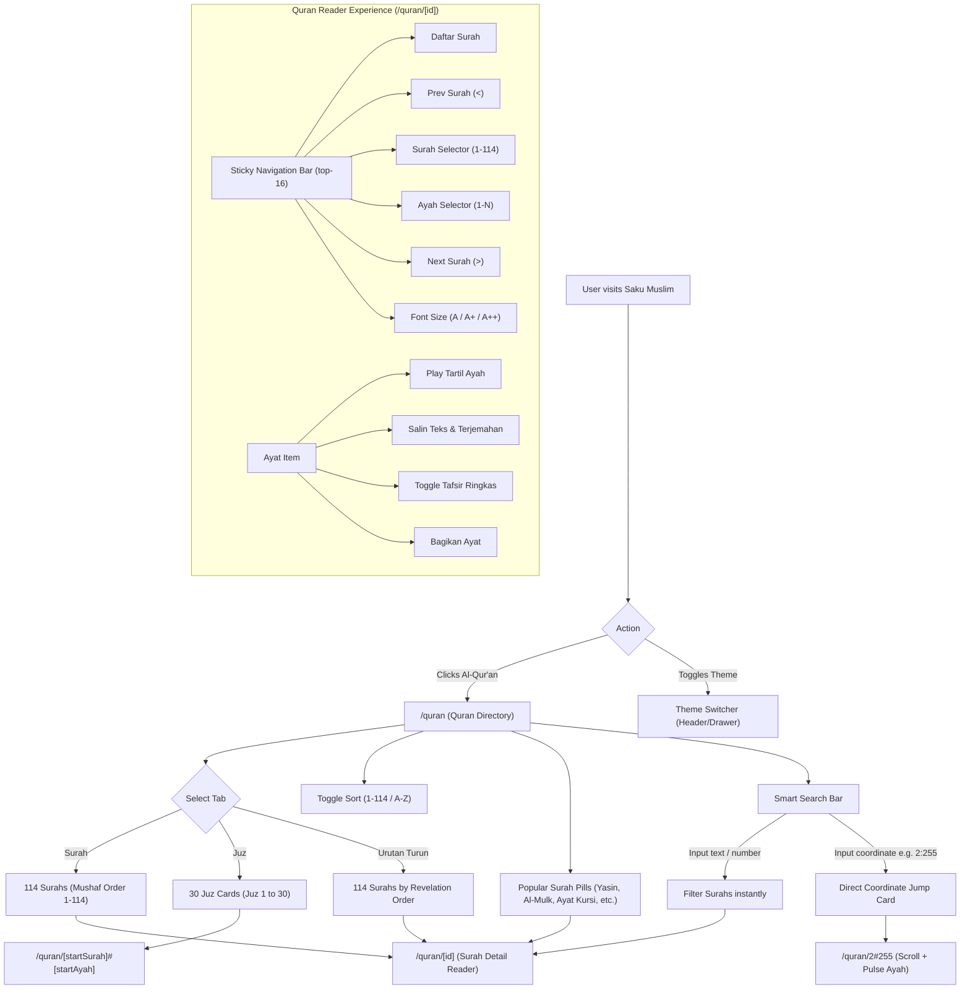

# TASK-003: Al-Qur'an NU Online Alignment & Global Theme Switcher — UI/UX Design Specification

> **Author:** Angel (`angel_uiux` — Senior UI/UX Designer)  
> **Status:** APPROVED & BINDING  
> **Date:** 2026-10-21  
> **Target Release:** Saku Muslim Web v1.2  
> **Reference Acuan:** [NU Online Al-Qur'an](https://quran.nu.or.id/) & Saku Muslim Design System  
> **Deliverable File:** `workflow/TASK-003-quran-nu-alignment-theme-switcher/02_design_angel.md`

---

## 1. Executive Summary & Design Rationale

### 1.1 Context & Objective
Saku Muslim v1.2 elevates the digital mushaf experience by aligning closely with the user-tested, culturally authentic conventions of **NU Online Al-Qur'an (`quran.nu.or.id`)**, while maintaining Saku Muslim's hallmark modern emerald-and-gold design language.

This specification provides the blueprint for:
1. **Quran Directory (`/quran`)**: Full 3-tab categorization (**Surah**, **Juz**, and **Urutan Turun**), alphabetical/numerical sort toggle, popular surah quick-jump pills, and an intelligent search bar with direct ayah coordinate jump (e.g. `2:255` for Ayat Kursi).
2. **Quran Reader (`/quran/[id]`)**: Full 114 surah presentation with zero dummy verses, a sticky navigation top bar matching NU Online's ergonomic controls (Surah & Ayah selectors, previous/next surah jumpers), dynamic font sizing, Bismillah ornament, ayah action toolbar (tartil audio, copy, tafsir ringkas toggle, share), Arabic typography with U+06DD (`۝`) end-of-ayah medallions, and collapsible Kemenag Tafsir Ringkas cards.
3. **Global Theme Switcher**: Hydration-safe, flicker-free Light (`☀️`), Dark (`🌙`), and System (`💻`) selector integrated into the primary desktop header (adjacent to the "Waktu Sholat" pill) and within the mobile navigation drawer.

---

## 2. Design Tokens & Color Palette Matrix

The visual system builds upon Tailwind CSS v4 `@theme inline` variables defined in `src/app/globals.css`.

### 2.1 Color Tokens Table

| Token Name | Light Mode Value | Dark Mode Value | Usage / Semantic Role |
|---|---|---|---|
| `--background` | `#f8fafc` (slate-50) | `#090d16` (deep obsidian) | Page canvas background |
| `--foreground` | `#0f172a` (slate-900) | `#f8fafc` (slate-50) | Primary text and headings |
| `--card` | `#ffffff` (pure white) | `#0f172a` (slate-900) | Cards, modals, dropdown surfaces |
| `--card-foreground`| `#0f172a` (slate-900) | `#f8fafc` (slate-50) | Text inside cards |
| `--primary` | `#059669` (emerald-600) | `#10b981` (emerald-500) | Primary brand accent, active tabs, buttons |
| `--primary-foreground` | `#ffffff` | `#022c22` (emerald-950) | Text on primary fills |
| `--secondary` | `#ecfdf5` (emerald-50) | `#064e3b` (emerald-900) | Subdued badges, verse number tiles |
| `--secondary-foreground` | `#065f46` (emerald-800) | `#a7f3d0` (emerald-200) | Text inside subdued badges |
| `--muted` | `#f1f5f9` (slate-100) | `#1e293b` (slate-800) | Inactive pill backgrounds, subtle dividers |
| `--muted-foreground` | `#64748b` (slate-500) | `#94a3b8` (slate-400) | Secondary metadata, ayah coordinate tags |
| `--accent` | `#d97706` (amber-600) | `#f59e0b` (amber-500) | Highlights, Ayat Kursi tag, audio pulse |
| `--accent-foreground` | `#ffffff` | `#451a03` (amber-950) | Text on accent fills |
| `--border` | `#e2e8f0` (slate-200) | `#1e293b` (slate-800) | Structural card borders and divider lines |
| `--ring` | `#059669` (emerald-600) | `#10b981` (emerald-500) | Keyboard focus indicator outline |

### 2.2 Dedicated Quran Nuance Tokens
- **Arabic End-Ayah Medallion (`۝`)**: Light mode `#059669` / Dark mode `#34d399` (`text-emerald-600 dark:text-emerald-400`).
- **Transliteration Text**: Light mode `#047857` (emerald-700) / Dark mode `#6ee7b7` (emerald-300), italicized with font-weight `500`.
- **Tafsir Accent Surface**: Light mode `#fefce8` (amber-50/50) with border `#fef08a` / Dark mode `#1c1917` with border `#78350f` (amber-900/40).
- **Sticky Glassmorphism**: `backdrop-blur-md bg-background/90 dark:bg-background/85 border-b border-border`.

### 2.3 Typography Matrix

```
┌────────────────────────┬───────────────────────────────────┬─────────────────────────────────┐
│ Text Element           │ Font Family & Fallbacks           │ Sizing & Line-Height            │
├────────────────────────┼───────────────────────────────────┼─────────────────────────────────┤
│ Arabic Script (Mushaf) │ 'Amiri', 'Traditional Arabic',    │ sm: 24px (1.5rem) / line 2.2    │
│                        │ 'Scheherazade New', serif         │ md: 32px-36px / line 2.2        │
│                        │                                   │ lg: 40px-48px / line 2.4        │
├────────────────────────┼───────────────────────────────────┼─────────────────────────────────┤
│ Latin Transliteration  │ var(--font-geist-sans), sans-serif│ 13px-14px (text-sm) / line 1.6  │
├────────────────────────┼───────────────────────────────────┼─────────────────────────────────┤
│ Indonesian Translation │ var(--font-geist-sans), sans-serif│ 14px-15px (text-sm-base) / 1.7  │
├────────────────────────┼───────────────────────────────────┼─────────────────────────────────┤
│ Tafsir Ringkas Body    │ var(--font-geist-sans), sans-serif│ 13px-14px / line 1.65           │
├────────────────────────┼───────────────────────────────────┼─────────────────────────────────┤
│ Number Badges & Labels │ var(--font-geist-sans), sans-serif│ 11px-12px (text-xs) font-bold   │
└────────────────────────┴───────────────────────────────────┴─────────────────────────────────┘
```

> [!IMPORTANT]
> **Line Height Rule for Arabic Text:** Line-height for Arabic text MUST NEVER be less than `2.0` (`leading-[2.0]` to `leading-[2.4]`). Arabic harakat (fathah, kasrah, dhammah, tanwin, shaddah, sukun) require vertical breathing space to prevent glyph collisions and maintain readability across screen resolutions.

---

## 3. Information Architecture & User Flow

### 3.1 Quran Navigation Diagram



---

## 4. Quran Directory (`/quran`) UI/UX Specifications

### 4.1 Page Layout Grid
- **Container**: `mx-auto max-w-7xl px-4 sm:px-6 lg:px-8 py-6 sm:py-10`.
- **Vertical Rhythm**: `space-y-6 sm:space-y-8`.

### 4.2 Hero Banner Component (`QuranHeroBanner`)
- **Visual Design**:
  - Background: Gradient `from-emerald-900 via-emerald-800 to-teal-950 text-white`.
  - Geometric Motif: Subtle SVG arabesque/Islamic pattern overlay with `opacity-10`.
  - Border: `border border-emerald-700/50`.
  - Corner Radius: `rounded-3xl` (`p-6 sm:p-8`).
  - Drop Shadow: `shadow-lg shadow-emerald-950/20`.
- **Hierarchy & Content**:
  - Overline Badge: `text-xs uppercase font-bold tracking-widest text-emerald-300` ("Kitab Suci Umat Islam").
  - Title: `text-2xl sm:text-3xl lg:text-4xl font-extrabold tracking-tight text-white` ("Al-Qur'anul Karim").
  - Subtitle: `text-xs sm:text-sm text-emerald-100 max-w-2xl mt-1 leading-relaxed` ("Baca mushaf 30 Juz lengkap 114 Surah dengan terjemahan resmi Kemenag RI, transliterasi latin, dan lantunan murottal Syeikh Mishary Rashid Alafasy.").
  - "Terakhir Dibaca" (Last Read) Widget:
    - If `localStorage.getItem("quran_last_read")` is populated:
      - Display an interactive card on the right side:
      - Icon: Open book glyph inside golden badge (`bg-amber-400 text-amber-950`).
      - Text: "Terakhir Dibaca" (`text-[11px] text-emerald-200`) → Surah Name (`text-sm font-bold text-white`) → "Ayat X" (`text-xs text-amber-300`).
      - Click targets `/quran/[id]#[ayahNumber]` directly.

### 4.3 Smart Search Box (`QuranSmartSearch`)
Inspired by `quran.nu.or.id`'s search input with coordinate resolution:
- **Container**: Rounded pill (`rounded-full border border-border bg-card px-4 py-3 shadow-xs transition-all focus-within:border-primary focus-within:ring-2 focus-within:ring-primary/20`).
- **Input Specs**:
  - Placeholder: `Cari nama surah, nomor, atau koordinat (misal: Al-Kahfi, 36, atau 2:255)...`
  - Left Icon: Search magnifying glass SVG (`w-5 h-5 text-muted-foreground`).
  - Right Icon: Clear `✕` button when query > 0 (`w-4 h-4 text-muted-foreground hover:text-foreground`).
  - Keyboard Shortcut Hint: Desktop pill showing `Ctrl + K` or `/` to focus.
- **Coordinate Parser Feedback**:
  - Regex detection for format `^\s*(\d{1,3})\s*:\s*(\d{1,3})\s*$`.
  - When pattern matches valid surah (1..114) and verse (1..maxAyah):
    - Display an instant **Direct Coordinate Jump Card** directly beneath the search bar:
    ```
    ┌────────────────────────────────────────────────────────────────────────┐
    │ ⚡ Loncat Langsung ke Ayat:                                           │
    │ [2:255] Surah Al-Baqarah Ayat 255 (Ayat Kursi)               [Buka →] │
    └────────────────────────────────────────────────────────────────────────┘
    ```
    - Styling: `bg-emerald-50 dark:bg-emerald-950/60 border border-emerald-300 dark:border-emerald-800 text-emerald-900 dark:text-emerald-200 rounded-2xl p-3.5 flex items-center justify-between cursor-pointer hover:bg-emerald-100 transition-colors`.

### 4.4 Popular Surah Quick Pills (`PopularSurahPills`)
Placed directly below the search bar for zero-friction access to high-frequency surahs:
- **Pills List**:
  1. `Yasin (36)`
  2. `Al-Waqi'ah (56)`
  3. `Al-Mulk (67)`
  4. `Al-Kahfi (18)`
  5. `Ar-Rahman (55)`
  6. `Ayat Kursi (2:255)` *(Coordinate Jump)*
- **Styling**:
  - Base: `inline-flex items-center gap-1.5 px-3.5 py-1.5 rounded-full text-xs font-semibold border transition-all cursor-pointer`.
  - Inactive: `border-border bg-card text-foreground hover:border-primary/50 hover:bg-secondary/40`.
  - Highlight ("Ayat Kursi"): Golden border `border-amber-300 dark:border-amber-700 bg-amber-50 dark:bg-amber-950/50 text-amber-900 dark:text-amber-200`.

### 4.5 Segmented Directory Tabs (`DirectoryTabs`)
Matches NU Online's 3-way view toggle with Sort option:
- **Tab List (`role="tablist"`)**:
  - Container: Pill wrapper `p-1 rounded-full bg-muted/80 border border-border inline-flex items-center gap-1`.
  - Tabs:
    1. **Surah (114)**: Default mushaf sequence (1 Al-Fatihah to 114 An-Nas).
    2. **Juz (30)**: 30 Juz cards with starting & ending ayah markers.
    3. **Urutan Turun (114)**: Chronological revelation order (Nuzul: starting with 96 Al-'Alaq, 68 Al-Qalam, etc.).
- **Active Tab Pill**:
  - `bg-card text-foreground font-bold shadow-xs rounded-full px-4 py-1.5 text-xs sm:text-sm transition-all`.
- **Inactive Tab Pill**:
  - `text-muted-foreground hover:text-foreground font-medium rounded-full px-4 py-1.5 text-xs sm:text-sm transition-all`.
- **Sort Button (`SortToggle`)**:
  - Placed on the right of the tab bar.
  - Toggles between:
    - `1-114` (Default numerical order)
    - `A-Z` (Alphabetical order by Latin name)
    - `Z-A` (Reverse alphabetical order)
  - Styling: `inline-flex items-center gap-1.5 px-3 py-1.5 rounded-full text-xs font-semibold border border-border bg-card text-foreground hover:bg-muted transition-colors`.

### 4.6 Card Specifications

#### A. Surah Card (`CardSurah`)
```
┌─────────────────────────────────────────────────────────────┐
│ [ 001 ]  Al-Fatihah                         الفاتحة  (▶)    │
│          Pembukaan · Makkiyah · 7 ayat                      │
└─────────────────────────────────────────────────────────────┘
```
- **Structure**:
  - Outer Wrapper: `flex items-center justify-between p-4 rounded-2xl border border-border bg-card hover:border-primary/50 hover:shadow-md transition-all group cursor-pointer`.
  - Left Badge (Number): `w-11 h-11 rounded-xl bg-secondary text-secondary-foreground font-bold text-xs flex items-center justify-center shrink-0 group-hover:bg-primary group-hover:text-primary-foreground transition-colors`.
  - Latin Title: `text-sm sm:text-base font-bold text-foreground group-hover:text-primary transition-colors truncate`.
  - Subtitle: `text-xs text-muted-foreground mt-0.5 truncate` ("{nameIndonesian} · {revelationType} · {numberOfAyahs} ayat").
  - Arabic Name: `font-arabic text-xl sm:text-2xl font-bold text-foreground group-hover:text-primary transition-colors shrink-0 pr-2` (`dir="rtl"`).
  - Quick Listen Play Button: `h-8 w-8 rounded-lg flex items-center justify-center text-muted-foreground hover:bg-secondary hover:text-primary transition-colors` (triggers floating audio player with full surah murottal).

#### B. Juz Card (`CardJuz`)
```
┌─────────────────────────────────────────────────────────────┐
│ [ JUZ 1 ]  Juz 1                                   ( 148 )  │
│            Al-Fatihah: 1  ―  Al-Baqarah: 141        Ayat    │
│            [ Baca Juz 1 → ]                                 │
└─────────────────────────────────────────────────────────────┘
```
- **Structure**:
  - Outer Wrapper: `flex flex-col p-5 rounded-2xl border border-border bg-card hover:border-primary/50 hover:shadow-md transition-all gap-3.5`.
  - Header Row:
    - Juz Badge: `px-3 py-1 rounded-lg bg-emerald-100 text-emerald-800 dark:bg-emerald-950 dark:text-emerald-300 font-extrabold text-xs tracking-wider uppercase` ("JUZ {juzNumber}").
    - Total Ayah Counter: `text-xs font-semibold text-muted-foreground` ("{totalVerses} Ayat").
  - Content Row:
    - Range Tag: `text-sm font-bold text-foreground` (e.g. `QS. Al-Fatihah: 1 – QS. Al-Baqarah: 141`).
    - Subtext: `text-xs text-muted-foreground` ("Awal: Al-Fatihah (Ayat 1) · Akhir: Al-Baqarah (Ayat 141)").
  - Action Button:
    - `inline-flex items-center justify-center gap-2 w-full py-2 px-3 rounded-xl bg-secondary hover:bg-primary hover:text-primary-foreground text-secondary-foreground text-xs font-bold transition-all` ("Buka Juz {juzNumber} →"). Link targets `/quran/[startSurahNumber]#[startAyah]`.

#### C. Urutan Turun Card (`CardUrutanTurun`)
```
┌─────────────────────────────────────────────────────────────┐
│ [ #1 ]   Al-'Alaq (Mushaf #96)                  العلق       │
│          Segumpal Darah · Makkiyah · 5 ayat pertama         │
└─────────────────────────────────────────────────────────────┘
```
- **Structure**:
  - Displays chronological sequence badge (`#1` to `#114`) with a label highlighting difference from canonical Mushaf number (e.g. `Urutan Turun ke-1 (Mushaf #96)`).
  - Revelation badge: Makkiyah (amber tinted) vs Madaniyah (emerald tinted).

---

## 5. Quran Reader (`/quran/[id]`) UI/UX Specifications

### 5.1 Sticky Top Bar Control (`StickyReaderBar`)
Fixed directly beneath the global header when scrolling (`sticky top-16 z-30`):

```
┌─────────────────────────────────────────────────────────────────────────────────────────────────┐
│ [← Daftar Surah] │ [<] [Al-Baqarah ▾] [Ayat ▾] [>] │ [Font: A A+ A++] [✓ Latin] [✓ Terjemahan] │
└─────────────────────────────────────────────────────────────────────────────────────────────────┘
```

- **Container Specifications**:
  - Dimensions: `h-14 w-full border-b border-border bg-background/95 backdrop-blur-md px-3 sm:px-6 flex items-center justify-between shadow-xs`.
- **Left Action**:
  - `Daftar Surah` Button: `inline-flex items-center gap-1.5 text-xs sm:text-sm font-semibold text-muted-foreground hover:text-foreground transition-colors`. In mobile view (<640px), collapses to `<` icon with tooltip.
- **Center Navigation Cluster**:
  - **Previous Surah Button (`<`)**:
    - Disabled state on Surah 1 (`opacity-30 pointer-events-none`).
    - Active state: links to `/quran/[id-1]`.
  - **Surah Selector Dropdown**:
    - Trigger button: `inline-flex items-center gap-1.5 px-3 py-1.5 rounded-full border border-border bg-card text-xs sm:text-sm font-bold text-foreground hover:border-primary shadow-xs`.
    - Popover modal: Max height `380px`, sticky search input at top, scrollable list of 114 surahs with number, latin name, arabic name, and total ayat. Clicking any surah navigates instantly.
  - **Ayat Selector Dropdown**:
    - Trigger button: `inline-flex items-center gap-1.5 px-3 py-1.5 rounded-full border border-border bg-card text-xs sm:text-sm font-bold text-foreground hover:border-primary shadow-xs`.
    - Popover modal: Grid of numbers `1` to `N` (total ayahs in current surah).
    - Interaction: Clicking Ayah `50` smoothly scrolls viewport to `#ayah-50` with an animated pulse highlight (`ring-2 ring-emerald-500 bg-emerald-50/50 dark:bg-emerald-950/30 transition-all duration-700`).
  - **Next Surah Button (`>`)**:
    - Disabled state on Surah 114 (`opacity-30 pointer-events-none`).
    - Active state: links to `/quran/[id+1]`.
- **Right Reading Settings Toolbar**:
  - **Font Size Pills**:
    - 3 sizes: `A` (sm), `A+` (md - default), `A++` (lg).
    - `px-2 py-0.5 rounded-md text-xs font-bold border transition-colors`.
  - **Latin Transliteration Checkbox / Toggle**:
    - Allows reciter to hide/show transliteration.
  - **Terjemahan Checkbox / Toggle**:
    - Allows reciter to hide/show Indonesian translation.

### 5.2 Surah Meta Header Banner (`SurahMetaHeader`)
Displayed at the top of the reader page:
- **Visual Design**:
  - Gradient: `from-emerald-900 via-emerald-800 to-teal-950 text-white rounded-3xl p-6 sm:p-10 text-center shadow-xl relative overflow-hidden`.
  - Inner Ornament: Geometric circular medallion in the background (`opacity-10 pointer-events-none`).
- **Elements**:
  - Meta Pills: `Surah {revelationType} · Juz {juzRange} · {numberOfAyahs} Ayat` (`text-xs font-semibold text-emerald-200 tracking-wide uppercase`).
  - Arabic Calligraphy Title: `font-arabic text-4xl sm:text-5xl lg:text-6xl font-black text-white my-3` (`dir="rtl"`).
  - Latin Title: `text-2xl sm:text-3xl font-extrabold text-white tracking-tight` ("Surah {nameLatin}").
  - Meaning: `text-sm text-emerald-100 font-medium` ("{nameIndonesian}").
  - Full Surah Audio Player Trigger:
    - `mt-6 inline-flex items-center gap-2 bg-amber-400 hover:bg-amber-300 text-amber-950 font-bold text-xs sm:text-sm px-5 py-2.5 rounded-xl shadow-md transition-all cursor-pointer`.
    - Play icon SVG + "Putar Murottal Full Surah (Syeikh Mishary Rashid Alafasy)".

### 5.3 Bismillah Banner (`BismillahOrnament`)
- **Conditional Rule**:
  - Render for all surahs **EXCEPT Surah 9 (At-Taubah)**.
  - Note: For Surah 1 (Al-Fatihah), Bismillah is Ayah 1; the banner can either serve as decorative header or standard Ayah 1. NU Online renders Bismillah as Ayah 1 for Al-Fatihah and as an unnumbered header banner for Surahs 2-8 and 10-114.
- **Visual Styling**:
  - Container: Centered, padded block `py-8 text-center`.
  - Arabic Script: `font-arabic text-3xl sm:text-4xl lg:text-5xl text-emerald-800 dark:text-emerald-300 font-bold leading-relaxed` (`dir="rtl"`).
    ```arabic
    بِسْمِ اللّٰهِ الرَّحْمٰنِ الرَّحِيْمِ
    ```
  - Subtitle: `text-xs sm:text-sm text-muted-foreground mt-2 italic` ("Dengan nama Allah Yang Maha Pengasih lagi Maha Penyayang").

### 5.4 Ayat Item (`AyatItem`) Specification

```
┌────────────────────────────────────────────────────────────────────────┐
│ [ 255 ]  QS. Al-Baqarah: 255             (▶ Tartil) (📋 Salin) (📖 Tafsir) (🔗) │
├────────────────────────────────────────────────────────────────────────┤
│                                                                        │
│  اللَّهُ لَا إِلَٰهَ إِلَّا هُوَ الْحَيُّ الْقَيُّومُ ۚ ... ۝٢٥٥               │
│                                                                        │
│  allâhu lâ ilâha illâ huwal-ḫayyul-qayyûm...                           │
│                                                                        │
│  Allah, tidak ada tuhan selain Dia, Yang Mahahidup lagi Maha Mandiri...│
│                                                                        │
│ ┌─ Tafsir Ringkas Kemenag RI ────────────────────────────────────────┐ │
│ │ Allah menjelaskan bahwa tidak ada sesembahan yang berhak disembah  │ │
│ │ selain Dia Yang Mahahidup kekal abadi dan Maha Mengurus makhluk-Nya│ │
│ └────────────────────────────────────────────────────────────────────┘ │
└────────────────────────────────────────────────────────────────────────┘
```

- **Card Outer Container**:
  - `id={`ayah-${ayah.numberInSurah}`}` (scroll anchor).
  - Classes: `flex flex-col p-5 sm:p-7 rounded-3xl border border-border bg-card shadow-xs hover:border-primary/40 transition-colors gap-4`.
- **Top Row (Coordinate & Action Toolbar)**:
  - Left Cluster:
    - Ayah Number Badge: `h-8 w-8 rounded-xl bg-secondary text-secondary-foreground font-bold text-xs flex items-center justify-center shrink-0`.
    - Coordinate Label: `text-xs font-semibold text-muted-foreground` (`QS. {surahName}: {ayahNumber}`).
  - Right Toolbar Actions:
    1. **Play Tartil Ayah (`AyahAudioButton`)**:
       - Icon: Play/Pause SVG (`w-4 h-4`).
       - Active State: Audio soundwave pulse animation in emerald (`text-primary animate-pulse`).
       - Accessibility: `aria-label="Putar audio ayat {ayahNumber}"`.
    2. **Copy Ayah (`CopyAyahButton`)**:
       - Icon: Clipboard SVG (`w-4 h-4`).
       - Copied state: Changes icon to checkmark with label `Tersalin ✓` (`text-emerald-600 font-bold text-xs`).
       - Payload format:
         ```text
         {ayah.arabic}

         "{ayah.translation}"
         (QS. {surahName}: {ayahNumber}) - Saku Muslim
         ```
    3. **Tafsir Toggle (`TafsirToggleButton`)**:
       - Label: "Tafsir" with small book icon.
       - Toggles expandable Tafsir card below.
       - Active state: `bg-secondary text-secondary-foreground font-bold`.
    4. **Share Ayah (`ShareAyahButton`)**:
       - Uses `navigator.share` on supported mobile devices; falls back to copying direct link `/quran/[id]#[ayahNumber]` to clipboard.
- **Arabic Text Typography**:
  - Text alignment: Right-to-left (`dir="rtl" text-right`).
  - Font: `font-arabic font-bold text-foreground`.
  - Font Size Dynamic Classes:
    - `sm`: `text-2xl sm:text-3xl leading-[2.2]`
    - `md`: `text-3xl sm:text-4xl lg:text-[2.75rem] leading-[2.2]`
    - `lg`: `text-4xl sm:text-5xl lg:text-6xl leading-[2.4]`
  - End-Ayah Medallion (`۝`):
    - Placed immediately at the end of the Arabic string:
    - `span.text-emerald-600 dark:text-emerald-400 font-arabic text-2xl sm:text-3xl pr-1.5` (`۝{ayahNumberInEasternArabic}`).
- **Transliteration**:
  - `text-xs sm:text-sm font-medium text-emerald-700 dark:text-emerald-400 italic leading-relaxed`.
- **Translation**:
  - `text-xs sm:text-sm text-foreground/90 leading-relaxed`.
- **Collapsible Tafsir Ringkas Card**:
  - Animated accordion with smooth open/collapse.
  - Border: `border-l-4 border-l-amber-500 border border-border bg-amber-50/40 dark:bg-amber-950/20 rounded-2xl p-4 sm:p-5 mt-2`.
  - Header: `flex items-center gap-2 mb-2`:
    - Pill: `bg-amber-100 text-amber-900 dark:bg-amber-900 dark:text-amber-200 text-[10px] font-bold px-2 py-0.5 rounded-md uppercase tracking-wider` ("Tafsir Ringkas Kemenag RI").
  - Content: `text-xs sm:text-sm text-muted-foreground leading-relaxed`.

### 5.5 Bottom Surah Navigation Footer (`SurahBottomNav`)
Placed at the end of the surah:
- **Left**: `← Surah Sebelumnya` (card linking to `surah.previousSurah`). Hidden if Surah 1.
- **Right**: `Surah Selanjutnya →` (card linking to `surah.nextSurah`). Hidden if Surah 114.
- Styling: Rounded-2xl cards with hover lift and emerald border accent.

---

## 6. Global Theme Switcher Specifications

### 6.1 Requirements & Strategy
- Must support 3 modes: **Light (`light`)**, **Dark (`dark`)**, **System (`system`)**.
- Implemented via `next-themes` and safe against hydration mismatch (using `useSyncExternalStore` or mounted guard).
- Zero Flash of Unstyled Content (FOUC).

### 6.2 Desktop Header Placement
- **Location**: In `src/components/shared/header.tsx` inside the right action cluster, immediately to the left of the `Waktu Sholat` pill.
- **Visual Design**:
  - Segmented pill container: `flex items-center gap-0.5 p-1 bg-muted/80 dark:bg-muted/60 rounded-full border border-border shadow-2xs h-9`.
  - 3 Button Segment:
    1. `☀️` Light
    2. `🌙` Dark
    3. `💻` System
  - Active Segment:
    - `bg-card text-foreground shadow-xs font-semibold rounded-full px-2.5 py-1 text-xs transition-all scale-[1.02]`.
  - Inactive Segment:
    - `text-muted-foreground hover:text-foreground rounded-full px-2 py-1 text-xs transition-all`.
  - Tap target: Height 32px, min-width 32px per icon button.

### 6.3 Mobile Navigation Drawer Placement
- **Location**: Inside the mobile drawer overlay when `mobileMenuOpen === true`.
- **Visual Design**:
  - Section Header: `text-xs font-semibold text-muted-foreground uppercase tracking-wider mb-2 px-1` ("Tema Tampilan").
  - Full-Width 3-Column Segmented Control:
    - Container: `grid grid-cols-3 gap-1 p-1 bg-muted rounded-xl border border-border`.
    - Each button has height `44px` (touch target standard) with centered icon + text label ("Terang", "Gelap", "Sistem").
    - Active item: `bg-card text-foreground font-bold shadow-xs rounded-lg`.

---

## 7. 8-State Component Matrix

Every interactive component adheres to the standard 8-state model to ensure bulletproof resilience:

| State | Tab Button / Pill | Surah / Juz Card | Ayah Action Button | Theme Switcher Segment |
|---|---|---|---|---|
| **1. Default** | Muted background, neutral text | Card surface, subtle border `#e2e8f0` / `#1e293b` | Ghost button, `text-muted-foreground` | Inactive segment, muted icon |
| **2. Hover** | Text darkens, subtle surface wash | Border transitions to `border-primary/50`, shadow lifts | `bg-muted text-primary` | `text-foreground hover:bg-card/50` |
| **3. Active/Pressed** | `bg-card` with shadow-xs & bold text | Scale `0.995`, immediate tactile feedback | Background darkens, icon depresses | Scale `1.02`, `bg-card text-foreground shadow-xs` |
| **4. Focus-Visible** | Ring-2 `ring-primary` offset-2 | Ring-2 `ring-primary` offset-2 | Ring-2 `ring-primary` offset-2 | Ring-2 `ring-primary` offset-2 |
| **5. Disabled** | `opacity-40 cursor-not-allowed` | `opacity-50 pointer-events-none` | `opacity-40 pointer-events-none` | `opacity-40 cursor-not-allowed` |
| **6. Loading / Skeleton** | Shimmer pulse pill | Shimmer card skeleton with simulated badge & title | Shimmer circle 32px | Pulse container skeleton |
| **7. Empty** | "Tab tidak memiliki item" | Dashed border card with search suggestion | Action unavailable badge | N/A (always 3 options) |
| **8. Error / Retry** | Red-tinted warning border | "Gagal memuat daftar, klik untuk memuat ulang" | Red alert tooltip | Fallback to System theme |

---

## 8. Accessibility & Antislop Standards

### 8.1 Accessibility (WCAG 2.1 Level AA)
1. **Contrast Ratios**:
   - Light Mode: Text `#0f172a` on `#f8fafc` = **14.2:1** (AAA).
   - Primary Emerald `#059669` on `#ffffff` = **4.65:1** (AA for normal text, AAA for large).
   - Dark Mode: Text `#f8fafc` on `#090d16` = **16.8:1** (AAA).
   - Dark Emerald `#10b981` on `#090d16` = **8.12:1** (AAA).
2. **Touch Targets**:
   - All interactive controls on mobile have a minimum hit area of **44px × 44px**.
3. **Keyboard & Screen Reader Support**:
   - Directory tabs implement `role="tablist"`, `role="tab"`, and `aria-selected="true|false"`.
   - Modals and popovers manage focus trapping and close upon `Escape` key press.
   - Ayah copy actions provide assistive technology announcements via `aria-live="polite"` ("Ayat {n} berhasil disalin ke papan klip").

### 8.2 Antislop & Cultural Craft Standards
- **No generic placeholder typography**: Arabic script uses authentic Naskh/Amiri styling with full vowel diacritics (harakat).
- **Accurate Ayah Ending Medallions**: The traditional Islamic end-of-ayah glyph `۝` (U+06DD) is rendered cleanly without overlapping surrounding characters.
- **No unstyled loading flashes**: The reader implements graceful skeleton loading states matching exact verse card dimensions to prevent cumulative layout shift (CLS < 0.05).
- **Graceful Offline Degradation**: The reader caches visited surahs in `localStorage` / CacheStorage so recitation continues seamlessly even if the reciter loses internet connectivity inside a mosque or during travel.

---

## 9. Implementation Handoff Checklist

### For Frontend Engineer (Fiqry — Track B):
- [ ] Implement `ThemeSwitcher` in `src/components/shared/header.tsx` for both desktop bar and mobile drawer.
- [ ] Upgrade `src/app/quran/quran-directory.tsx`:
  - Add 3 tabs: **Surah (114)**, **Juz (30)**, and **Urutan Turun (114)**.
  - Implement **A-Z / 1-114 sort toggle**.
  - Add **Popular Surah quick pills** (Yasin, Al-Waqi'ah, Al-Mulk, Al-Kahfi, Ar-Rahman, Ayat Kursi).
  - Implement **Coordinate search parser** (e.g. `2:255` direct jump).
- [ ] Upgrade `src/app/quran/[id]/surah-reader.tsx`:
  - Fetch dynamic verse & tafsir data for all 114 surahs via internal proxy / `equran.id` API v2.
  - Implement **Sticky Top Navigation Bar** with Surah & Ayah selectors.
  - Implement **Bismillah Banner** (suppressed for Surah 9).
  - Add **Ayah Toolbar**: Tartil audio, Copy text, Tafsir Ringkas collapsible accordion, and Share.
  - Add **Dynamic Font Sizing** (`sm`, `md`, `lg`) and transliteration/translation toggles.

### For QA Engineer (Sandra — Track C):
- [ ] Playwright E2E: Verify switching between Surah, Juz, and Urutan Turun tabs.
- [ ] Playwright E2E: Verify searching "2:255" renders Ayat Kursi jump card and navigates to `/quran/2#255`.
- [ ] Playwright E2E: Verify Surah 2 (Al-Baqarah) loads all 286 verses and Surah 9 (At-Taubah) omits Bismillah.
- [ ] Playwright E2E: Verify Theme Switcher toggles Light/Dark/System and persists across page reloads without FOUC.
